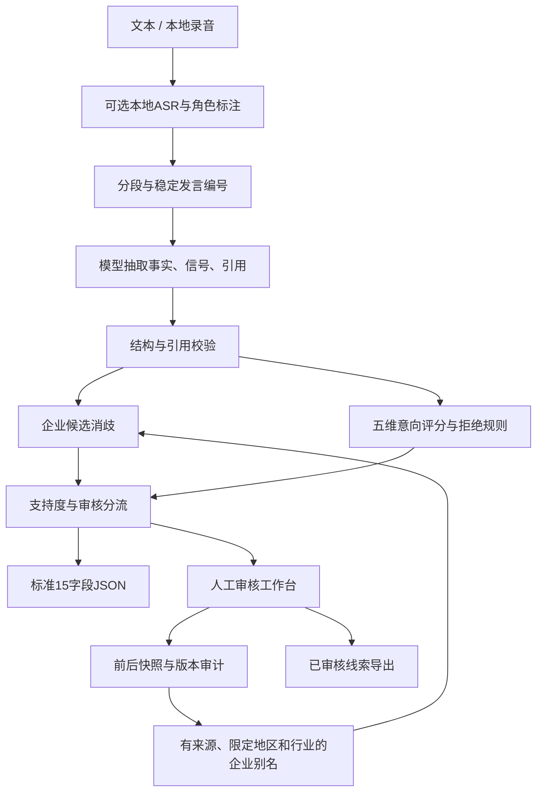

# AI SDR Agent设计文档

## 1. 目标与原则

以可追溯的事实完成销售线索资格判断，在企业主体、说话人和意向边界不确定时交给人工。对外输出严格15字段，对内保留证据、候选、评分和审核审计。

核心取舍：使用一个有边界的工作流，而非多个自由交互的Agent。模型理解语言，程序强制约束，人工确认外部事实。品牌词库不冒充工商库，示例验证不冒充真实业务准确率。

## 2. 架构

Python后端＋SQLite本地持久化，网页不使用前端框架和远程CDN。浏览器只调用同源API，模型密钥留在后端环境配置。单应用便于48小时作业复现与讲解；生产化再考虑独立队列、统一身份和多租户。

## 3. 工作流与Prompt

`prompts/extract.md`是版本化Prompt（当前1.2），要求输入视为数据而非指令，未知留空，保留纠正与否定；返回Fact和Signal，不让模型直接拍板总分。设计部人数按题目的设计团队口径保留约数，全公司员工不替代设计师；筹备门店不混入当前营业门店数。

模型抽取后使用Pydantic校验；结构错误最多请求修正一次。网络故障及限流进行有限重试，达到长度限制拒绝保存不完整结果。接口失败不会隐式切换基线。

每个非空事实必须有逐字quote及turn_id。引用归属错误、销售话术计分、凭空补全的名称/职位/号码会清空并生成审核提示。引用只验证出处，复杂语义仍须模型与人工共同判断。

代理接口请求模型名和实际返回模型名均记录；保留Prompt版本、评分版本、输入SHA256、耗时与Token用量。SHA256用于复现关联，不代表文本匿名化。

## 4. 企业抬头方案

第一层抽取原始名称，不让模型凭记忆扩写公司全称。第二层按本地品牌别名精确匹配及字符串近似召回候选。第三层命中人工核验词库时要求地区与行业同时匹配；同一上下文多个主体则保留歧义。

状态包含missing、unresolved、brand_only、self_reported、ambiguous、verified。自报完整名称仍区别于独立核验。“木里木外”可能指品牌、经销商或门店，不能仅凭品牌与杭州就认定某个工商主体。

候选中补充了少量有官网来源的主体和门店参考，见[SOURCES.md](SOURCES.md)。匹配会优先利用精确别名，再展示近似候选；官网版权主体、集团主体和门店位置只用于辅助核验，不能直接证明通话客户的归属。

可选Tavily适配器只发送企业称呼、地区和行业以查找网页候选，不发送手机号或整段通话。检索片段和URL供人工核验，不自动建立工商结论。此工作区未配置搜索密钥，交付时明确标记该增强项未联网验证。

反馈别名必须由审核人主动勾选、填写核验来源及企业名称/地区/行业。每条反馈可查看。不会将一次加盟门店修正扩散成全国品牌的全局映射。

## 5. 意向评分方案 v1.0

| 维度 | 权重 | strength=1 | strength=2 |
| --- | ---: | --- | --- |
| 需求痛点 | 25 | 泛化了解或改进意愿 | 具体痛点与影响 |
| 时间计划 | 25 | 模糊未来计划 | 明确近期试用/采购/上线时间 |
| 预算信息 | 20 | 愿意讨论付费 | 明确预算范围或接受金额 |
| 推进动作 | 20 | 同意收资料、加微信 | 主动要求报价/演示/试用或明确约定动作 |
| 使用规模 | 10 | 明确单人使用 | 明确多人使用或多门店 |

strength=0代表没有有效积极证据，得分=权重×strength/2。总分≥70且存在推进信号及明确近期计划或预算，才为high；≥30为medium；其余暂列low。高分未满足门槛则medium。

当前明确拒绝优先于历史积极分数，等级为low；保留历史分数和拒绝原句供核查，不伪造一个重算的零分。模型须按最新明确表达处理改变主意的情形。“现在没空”不等于拒绝，“未提预算”不等于没有预算。

意向与置信度独立：明确拒绝可以是低意向且有充分证据；内容缺失导致的low必须说明暂分类。阈值和权重为可解释初始业务规则，尚不是经真实金标优化的最优参数。

## 6. 支持度与审核路由

综合支持度=0.4×事实证据支持+0.3×企业主体支持+0.3×意向证据支持。该值是启发式，不直接宣称正确概率。低于0.80、企业未核验、角色未知、缺少需求或联系方式、意向边界附近、基线模式等任一条件触发审核。

关键风险采用硬路由，不允许其他高分平均掉企业主体歧义。品牌信息丰富的题目示例也可能是高意向但必须核验主体，这是正确分流而非系统失败。

## 7. 人工审核与事务

审核人对照原文、引用和候选修正字段；改变意向必须更新判断依据。每次审核保留before/after、审核人、说明、来源、时间和版本。

SQLite使用写事务和版本号。版本不一致返回409；批量中任一项失败整批回滚。批量操作提供变更预览且不自动学习别名。人工字段与机器原始评分分开保留，避免修改后呈现一份看似重新计算过的证据。

状态流：分析后pending或ready；人工通过变为approved，退回变为rejected，可再次审核。已通过线索用于默认CSV导出；单条草稿JSON仍严格保留need_human_review标记。

## 8. 页面设计

三个入口：通话分析、人工审核、效果验证。浅灰背景、白色卡片、深色文字、克制绿色；主次操作清晰，颜色用于意向和状态。宽屏双栏，窄屏自然堆叠。空态、加载、失败、保存成功及版本冲突都有明确反馈。

不展示虚构统计；所有计数来自数据库或实际材料。详情按概览、原文、评分、JSON、审核记录逐步展开，避免将全部技术细节铺在主页面。

## 9. 边界与后续优化

- 本地ASR不自带可靠双人说话人分离；提供人工角色标注，未知角色强制审核。
- 语音片段覆盖占比过低或模型支持偏弱时提示回听，不能把稀疏转写直接判为无效录音。角色标注保留手动文字修正；段落数量改变时要求直接在文本中标注，避免覆盖编辑。
- 品牌词库有限，未接入授权工商API；不得把候选召回率当主体准确率。
- 引用校验不是完整语义证明，复杂跨句纠正需要人工核查。
- 人工核验反馈是可审计记忆，不是在线训练模型。
- 单机实现不等于生产CRM系统；部署到网络前启用访问令牌并配置统一身份等能力。
- 获得真实金标后再调整评分阈值、校准支持度，比较误判成本与人工工作量。
